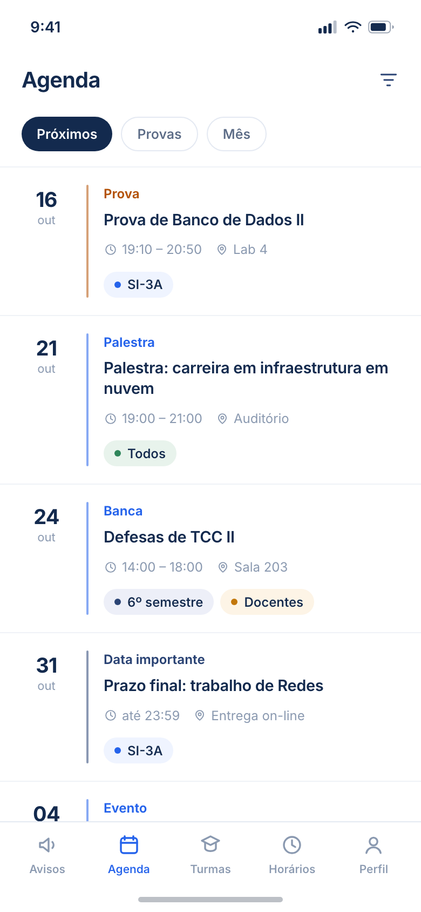
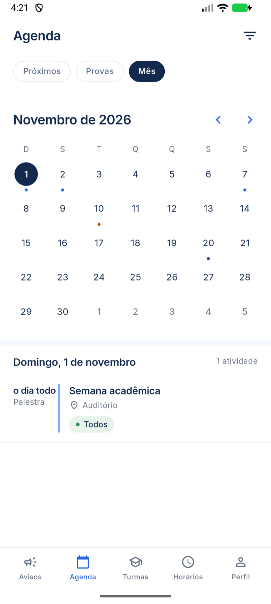
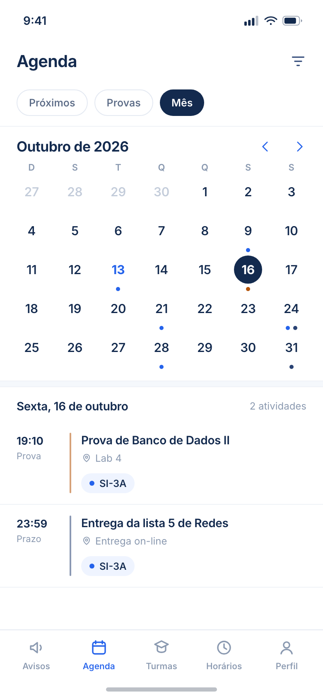
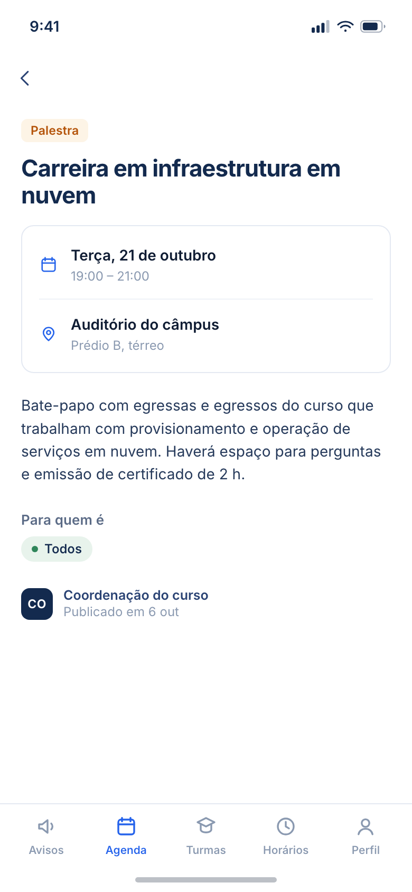
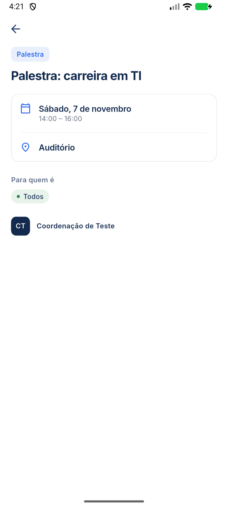
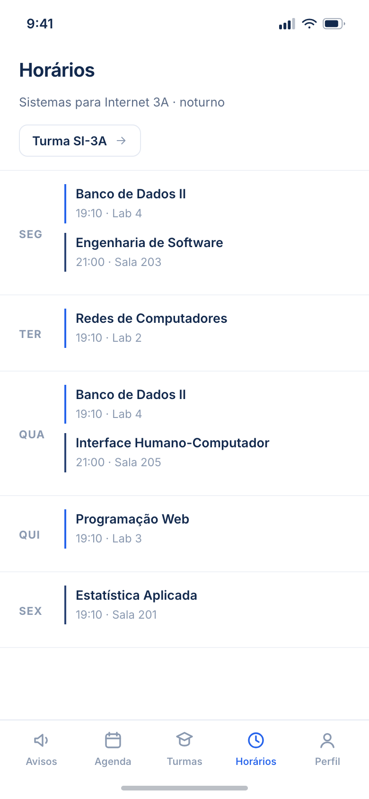
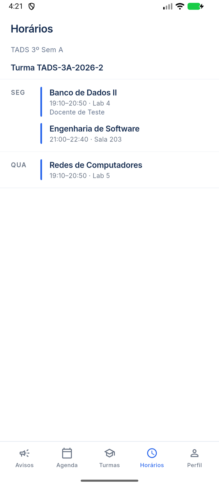

# Evidências do aplicativo — fase F2

> **Registro da fase F2, feito em 01/11/2026.** Os números de testes abaixo são os daquela data. As execuções finais, citadas no Apêndice B do TCC, estão em [`testes-app-final-2026-11-06.txt`](testes-app-final-2026-11-06.txt) (suítes completas e integração no emulador) e [`testes-app-por-teste-2026-11-10.txt`](testes-app-por-teste-2026-11-10.txt) (cada teste pelo nome). As capturas também são as daquela fase.

01/11/2026. Fecha as fases 11 e 12 de [`tasks-f2.md`](../specs/001-app-conecta/tasks-f2.md)
(T082–T088). A agenda (fases 9 e 10) entrou no [#28](https://github.com/ruansbueno/conecta/pull/28).
A saída das verificações está em [`testes-app-2026-11-01.txt`](testes-app-2026-11-01.txt).

## Resultado das verificações

| Verificação | Como | Resultado |
|---|---|---|
| Análise estática | `flutter analyze` | sem problemas |
| Unidade e widget | `flutter test` | 348 testes, todos passam |
| Integração no aparelho | `flutter test integration_test -d emulator-5554` (Android 16, emulador), servidor falso no contrato da E3 | 22 testes em 9 arquivos, todos passam |
| Mensagens de erro | `test/unit/mensagens_spec_test.dart` contra a tabela da spec §6, agora com `EVENTO_NAO_ENCONTRADO` | spec e app iguais |
| Sem rede (T085, SC-005) | `integration_test/offline_test.dart`: depois de visitar as abas, o app é reaberto sem servidor | Próximos, o mês corrente, o detalhe (com o evento que veio da lista) e a grade da turma abrem com o que estava guardado e a faixa com a data |
| Fonte a 200% (T086, RM-36) | `test/widget/escala_fonte_test.dart` e conferência no emulador com `font_scale 2.0` | sem estouro; a data do cartão, a sigla do dia da grade, o rótulo das abas e o tipo na lista do dia ficam numa linha só |
| Leitor de tela (T086, RM-35) | widget: dias do mês com nome que começa pelo número visível, estado selecionado e ação de toque; folhas de tipo e de turma; sigla do dia da grade lida por extenso ("Segunda") | passa |
| Horário de verão | `calendario_test` rodado também com `TZ=Europe/Berlin` | a grade do mês continua de domingo a sábado em todos os meses de 2026 a 2030 |

### Correções feitas nesta fase

- **Fonte a 200% no aparelho:** o teste de widget não acusa quebra de linha, só estouro, e a fonte de
  teste não tem as medidas da Inter. No emulador apareceram quebras no meio da palavra:
  - "QU / A" na sigla do dia;
  - "Horário / s" na aba;
  - "3 / 0" na data do cartão;
  - "Palest / ra" na lista do dia.

  Correções:
  - as colunas de data e de dia passam a acompanhar a escala da fonte;
  - o rótulo das abas e o tipo encolhem para caber (o nome lido pelo leitor de tela não muda).

  Os testes novos comparam a altura dessas linhas.
- **Grade com 403 numa turma que a lista ainda traz:** a tela não fica dando voltas. Cada turma que
  respondeu 403 ou 404 não é escolhida de novo na mesma rodada, e o erro mostra a mensagem própria
  ("Você não está mais nesta turma.").
- **Revisão independente:**
  - **Captura errada:** a m-10 tinha saído na visão de mês; foi refeita.
  - **Faixa de dados guardados:** não passa mais de uma turma para outra.
  - **Troca de turma:** o número do pedido vem antes de lembrar a escolha.
  - **Aviso breve:** sai de um ouvinte do controller, fora do `build`.
  - **Colunas:** crescem na proporção do texto (escala não linear do Android 14+).
  - **Botão da turma:** diz ao leitor de tela que troca a turma.
  - **Testes:** cobrem a turma lembrada esquecida no 403/404 e a SnackBar de fato.

**Limite conhecido:** Horários lista só a primeira página das turmas (20), o bastante para aluno e
docente do curso.

## Telas comparadas com o design (T087)

Capturas do emulador Android contra a API local real, com os dados do seed e o usuário
`aluno.teste`, reduzidas para 780 px como as da F1.

**Em todas as telas** valem as diferenças registradas na F1 ([`RELATORIO.md`](RELATORIO.md)): cor
`tenue` mais escura e barra de status do emulador.

| Design | Implementado | Diferenças deliberadas (plan-f2 D-AF2-11) |
|---|---|---|
|  |  | Nenhuma de estrutura. Evento de vários dias mostra "de 30/10 a 02/11" no lugar das horas. |
|  |  | Nos dias do meio de um evento de vários dias, a coluna de horário diz "o dia todo"; no último, "até HH:MM". |
|  |  | O cartão de local tem uma linha só, sem "Prédio B, térreo", porque a API tem um campo de local. O autor aparece sem "Publicado em", porque a API não informa a data de criação ao cliente; quando o evento foi editado, aparece "Editado …". O selo do tipo segue as cores da agenda (palestra em azul). A tela é empilhada, sem a barra de abas, como o detalhe do aviso. |
|  |  | Sem o turno ("noturno"), que a API não tem. Cada aula mostra também o fim e o docente, que a US6 pede. As barras são de uma cor só, porque a API não tem tipo de aula. Com uma turma só, o código aparece como texto; com mais de uma, o botão "Turma … →" abre a folha de turmas. |
