# Evidências do aplicativo — fase F1

29/10/2026. Fecha a fase 8 de [`tasks.md`](../specs/001-app-conecta/tasks.md) (T059–T066).
A saída completa de cada verificação está em [`testes-app-2026-10-29.txt`](testes-app-2026-10-29.txt).

## Resultado das verificações

| Verificação | Como | Resultado |
|---|---|---|
| Análise estática | `flutter analyze` (regras do projeto, incluindo a de nenhuma cor fora do tema, conferida em `design_system_test`) | sem problemas |
| Unidade e widget | `flutter test` | 273 testes, todos passam |
| Integração no aparelho | `flutter test integration_test -d emulator-5554` (Android 16, emulador), com um servidor falso que segue o contrato da API | 16 testes em 7 arquivos, todos passam |
| Mensagens de erro (T059) | `test/unit/mensagens_spec_test.dart` lê a tabela "Mensagens por código" da spec (§6) e compara com o mapa do app, nos dois sentidos | spec e app iguais |
| Acessibilidade (T060, SC-007) | `test/widget/acessibilidade_test.dart`: regras do Flutter (contraste de texto AA, alvo de toque de 48 dp, alvos com rótulo) em cada tela e diálogo da F1, nos estados vazio, de erro e sem rede, e a ordem de leitura da árvore de acessibilidade (a ordem em que o TalkBack percorre a tela) | nenhuma violação; ordem de leitura igual à ordem visual |
| Fonte a 200% (T061, RM-36) | `test/widget/escala_fonte_test.dart`: tela de 360 × 640 com a fonte do sistema dobrada | nenhuma tela corta ou estoura |
| Sem rede (T062, SC-005) | `integration_test/offline_test.dart`: entra, visita as abas, derruba o servidor (conexão recusada) e reconstrói o app com o mesmo armazenamento | Avisos, Turmas e Perfil abrem com conteúdo e a faixa com a data |
| Code desconhecido e log (T063, RM-38) | `integration_test/erro_desconhecido_test.dart` e `test/unit/api_client_test.dart` | mensagem genérica na tela; toda falha de API registrada uma vez no log local, com método, endpoint, status e code — inclusive resposta 200 em formato inesperado e corpo de erro malformado |
| Token (T064, SC-006) | `integration_test/token_seguro_test.dart`: depois do login e do uso, inspeciona as preferências (onde mora o cache) e o log | o token está só no armazenamento seguro |

### Correções feitas nesta fase

- **Log de falhas (RM-38):** só o `code` desconhecido era registrado, sem o endpoint e a cada leitura da
  mensagem. Agora toda falha vai para o log uma vez, sem token, query, corpo ou o texto do servidor,
  inclusive quando a API responde 200 num formato que o app não entende (mudança de contrato). O log
  é o do `dart:developer`: existe nas builds de depuração e de perfil, usadas para as evidências.
- **Contraste:** a cor `tenue` do design (#8A99B0, 2,9:1 sobre branco) foi escurecida na mesma matiz
  para #646F80 (5,1:1), como na plataforma web. Ela aparece nas abas inativas e nos textos de apoio.
- **Conteúdo do aviso:** continua selecionável por toque longo, mas deixou de ser um alvo de toque de
  uma linha só (22 px de altura).
- **Fonte a 200%:** a faixa de dados guardados, com "Tentar de novo" ao lado do texto, estourava e
  empurrava a lista quando o app abria sem rede. Com fonte grande, o botão desce para baixo do texto.

## Telas comparadas com o design (T065)

Capturas do emulador Android contra a API local real, com os dados do seed e o usuário `aluno.teste`,
reduzidas para a largura dos PNGs do design (780 px). Agenda, calendário, evento e horários (m-10 a
m-12) são da fase F2, comparados em [`RELATORIO-F2.md`](RELATORIO-F2.md). As capturas m-02 e m-04
foram refeitas em 01/11/2026, com as cinco abas e os filtros já alinhados à esquerda como no design.

**Em todas as telas** (diferenças deliberadas):

- A barra de abas tem as cinco abas desde a F2 (Agenda e Horários).
- A cor `tenue` está mais escura, pelo contraste AA.
- A barra de status é a do emulador (o design usa a de um iPhone).

| Design | Implementado | Diferenças deliberadas |
|---|---|---|
| 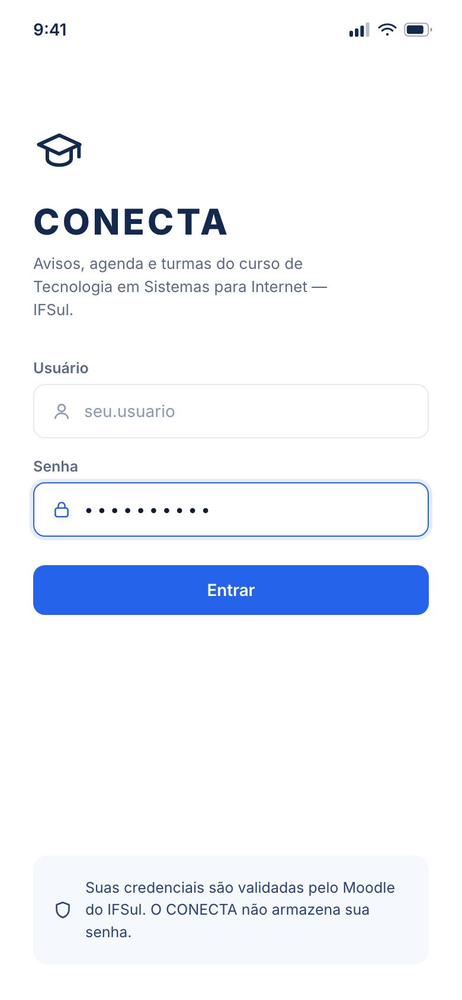 | 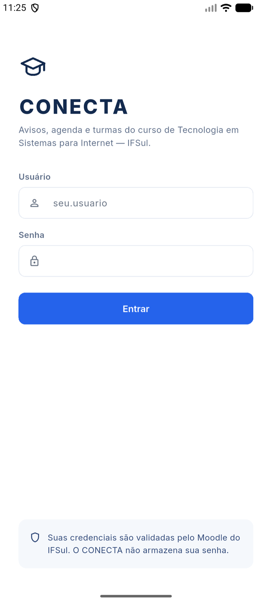 | Nenhuma de estrutura. |
| 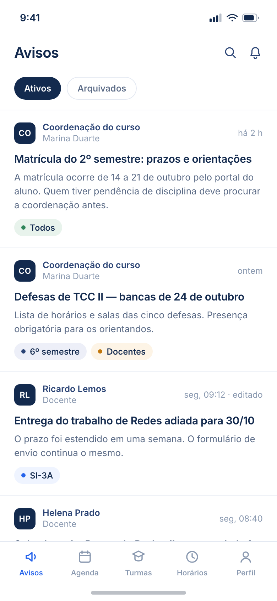 | 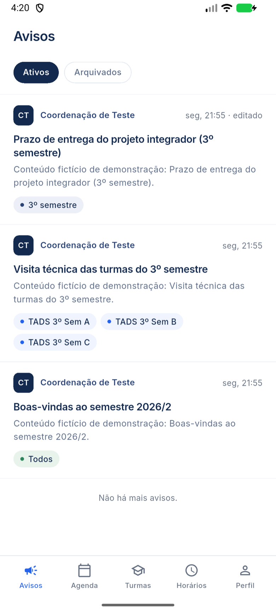 | Sem os ícones de busca e de notificações: a busca de avisos não existe no contrato e não há notificações na F1. O autor aparece sem o papel e o nome de quem publicou pela coordenação, porque a API manda só o nome do autor. |
| 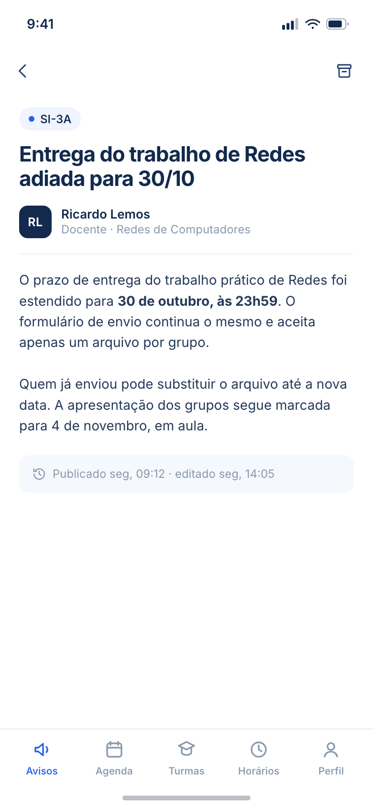 | 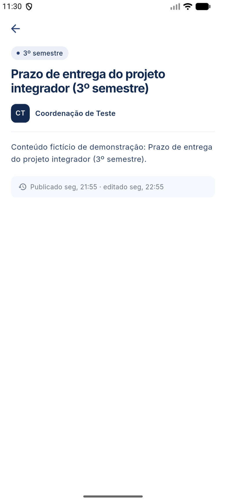 | Sem o botão de arquivar: o app só lê, e arquivar é da plataforma web. O conteúdo é texto simples (a API não manda formatação, como os negritos do design). O autor aparece sem o papel e a turma. |
| 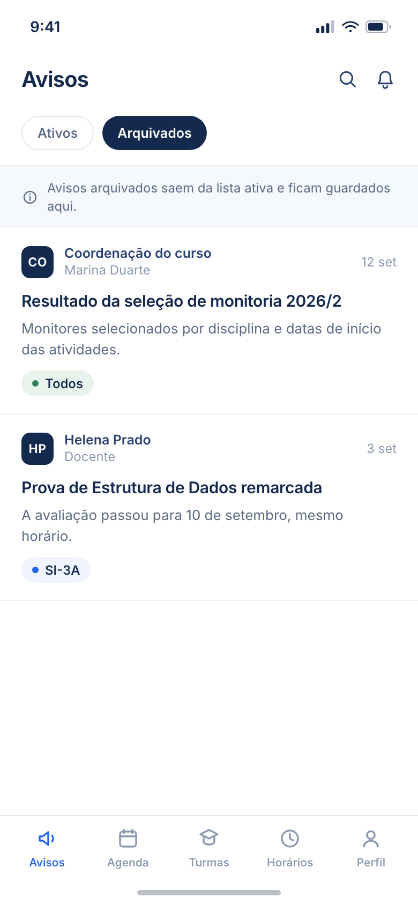 | 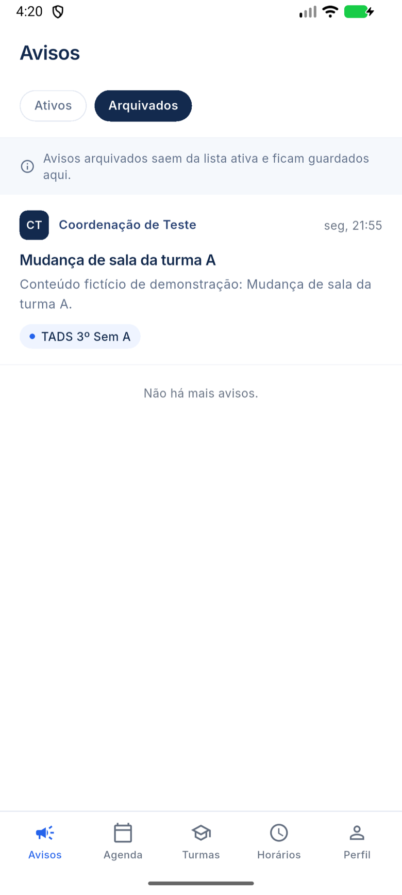 | As mesmas da lista de avisos. |
| 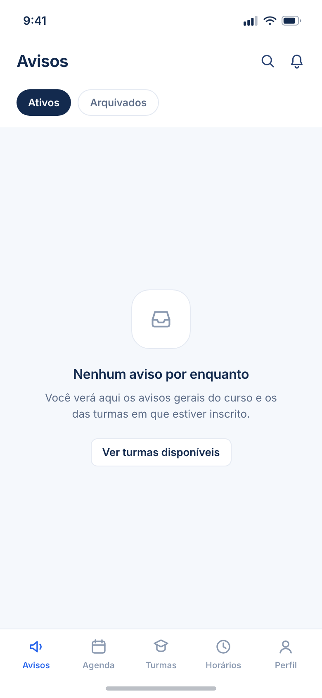 | sem captura | Não dá para reproduzir com o seed, porque os avisos para "Todos" alcançam todo mundo. O estado é coberto pelos testes `avisos_lista_test` e `acessibilidade_test`. O texto diz "das turmas de que você participa" em vez de "em que estiver inscrito", para não marcar gênero. O atalho "Ver turmas disponíveis" abre as turmas disponíveis. |
| 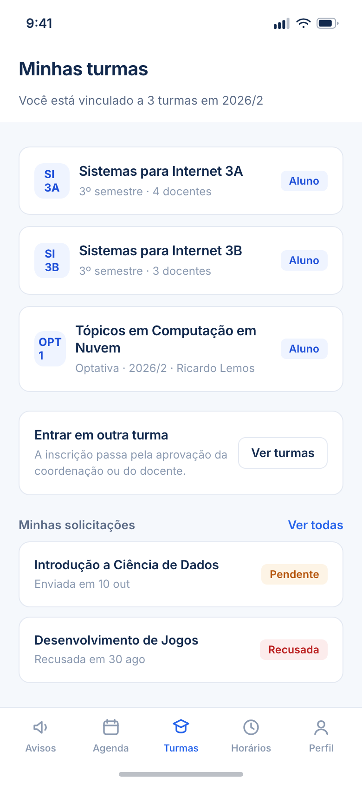 | 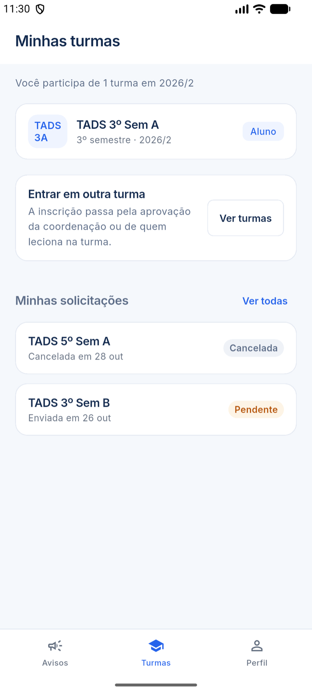 | O cartão mostra o período no lugar do número de docentes, que a API não informa. "Você participa de N turmas" no lugar de "Você está vinculado a…", sem marcar gênero. "Quem leciona na turma" no lugar de "o docente". |
| 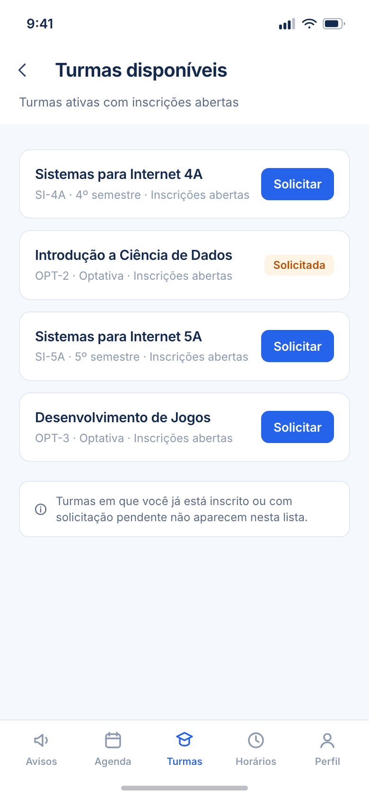 | 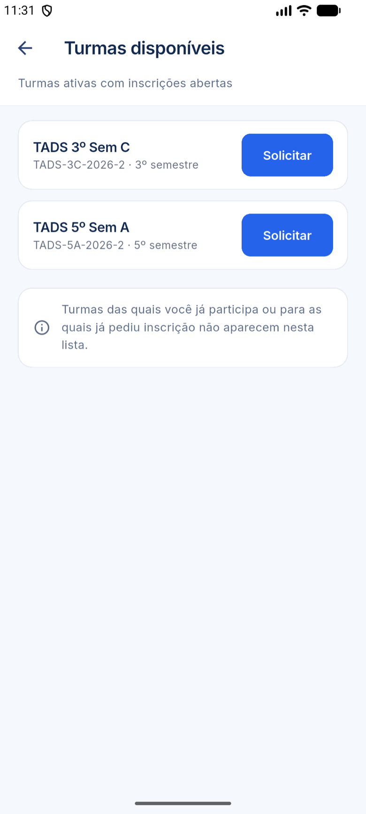 | Sem a marca "Solicitada": depois do pedido, a turma sai da lista (contrato §7; a API já exclui turmas com pedido pendente). A tela é empilhada sobre as abas, sem a barra de abas. O aviso do rodapé foi reescrito sem "inscrito". |
| 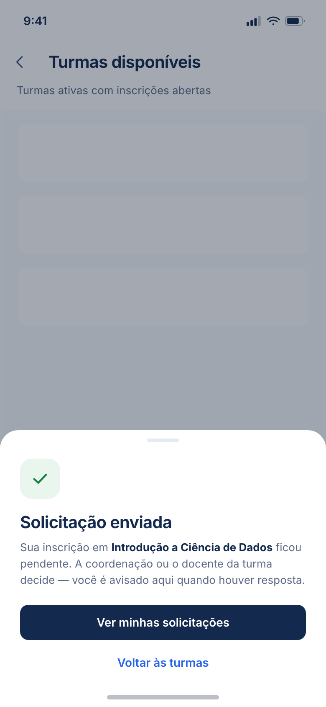 | 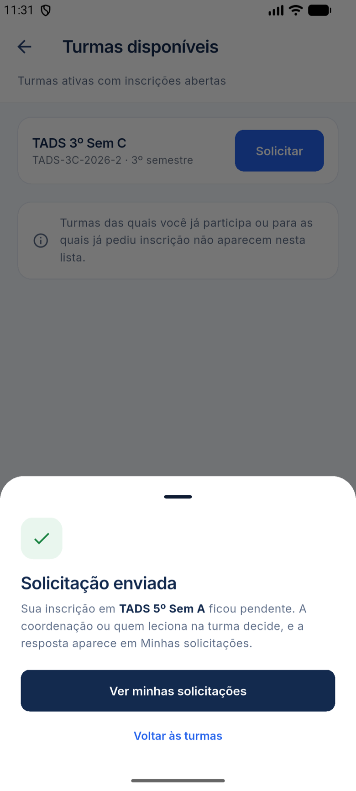 | "A resposta aparece em Minhas solicitações" no lugar de "você é avisado aqui": não há notificações na F1, e "avisado" marca gênero. |
| 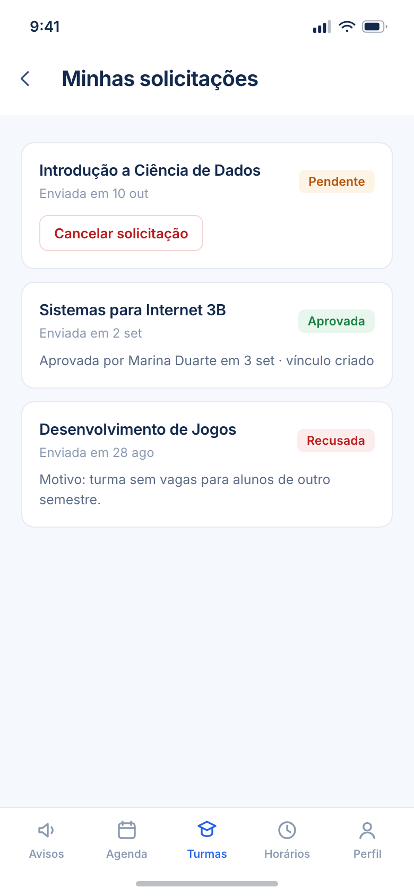 | 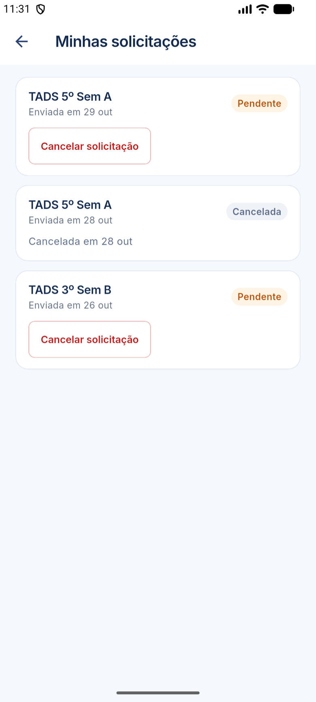 | A aprovação aparece sem "por Marina Duarte", porque a API não informa quem decidiu. As solicitações canceladas também aparecem. Tela empilhada, sem a barra de abas. |
| 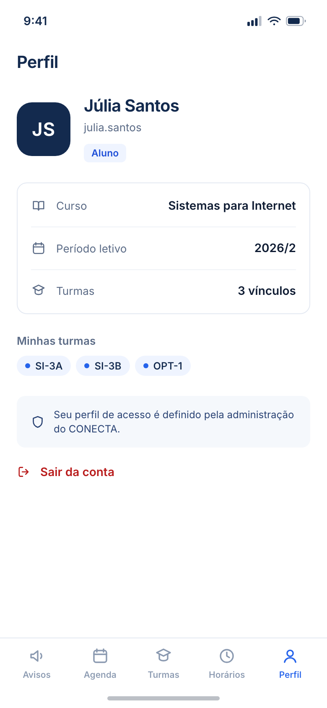 | 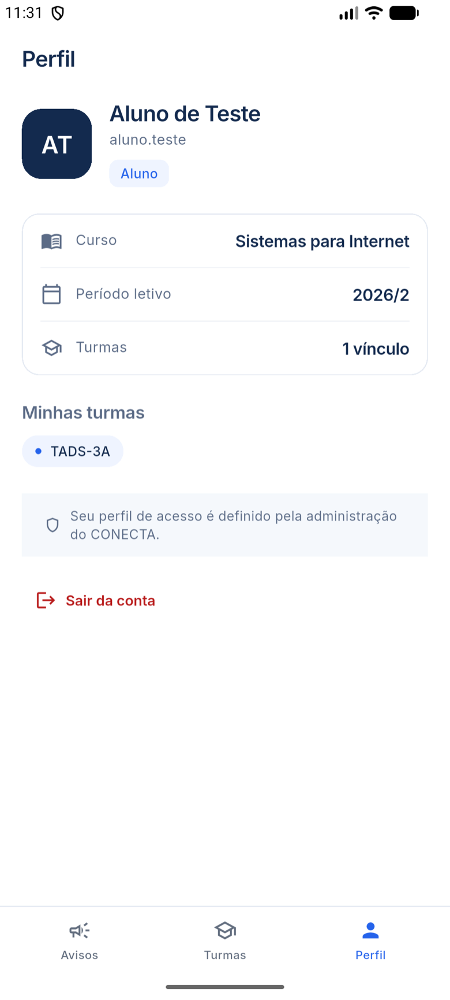 | O curso vem de uma constante do app (curso único) e o período, das turmas da pessoa, porque o `/me` não informa nenhum dos dois. A nota sobre o perfil de acesso usa a faixa informativa do app (cantos retos, largura toda) em vez da caixa arredondada do design, e "Sair da conta" é um botão de texto com a margem do tema. |

O pedido feito na TADS 5A para a captura m-08 foi cancelado logo depois, e o banco local ficou com
esse registro de solicitação cancelada.
