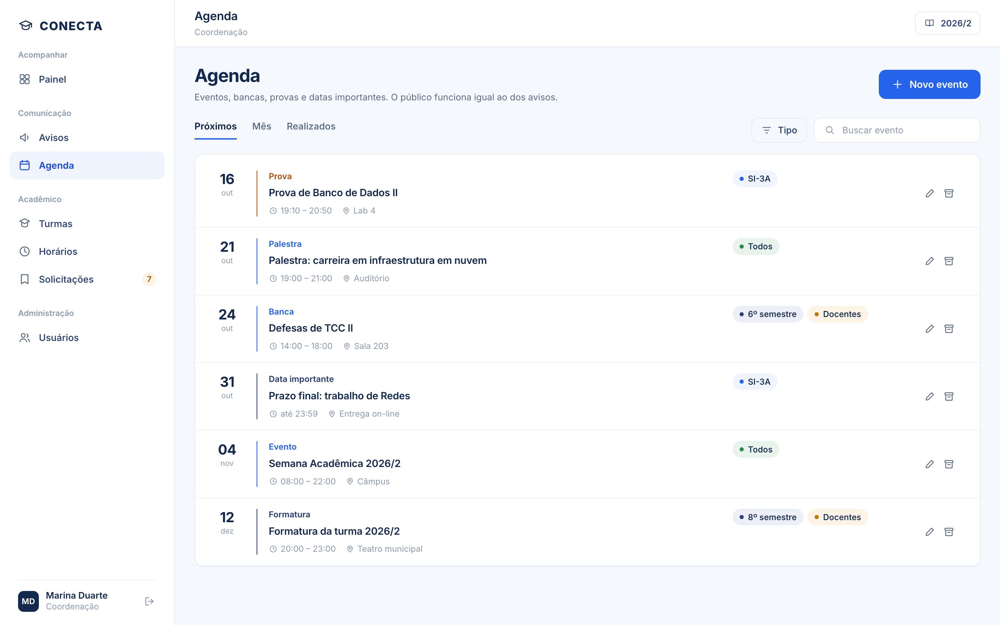
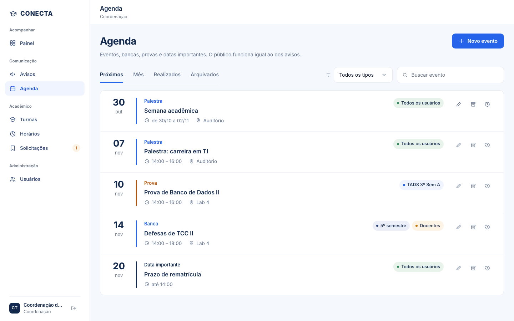
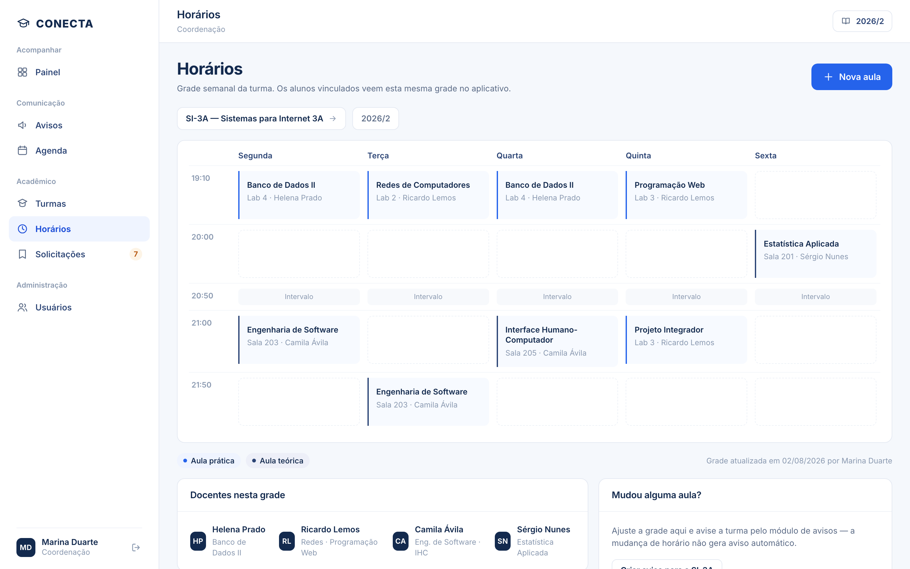
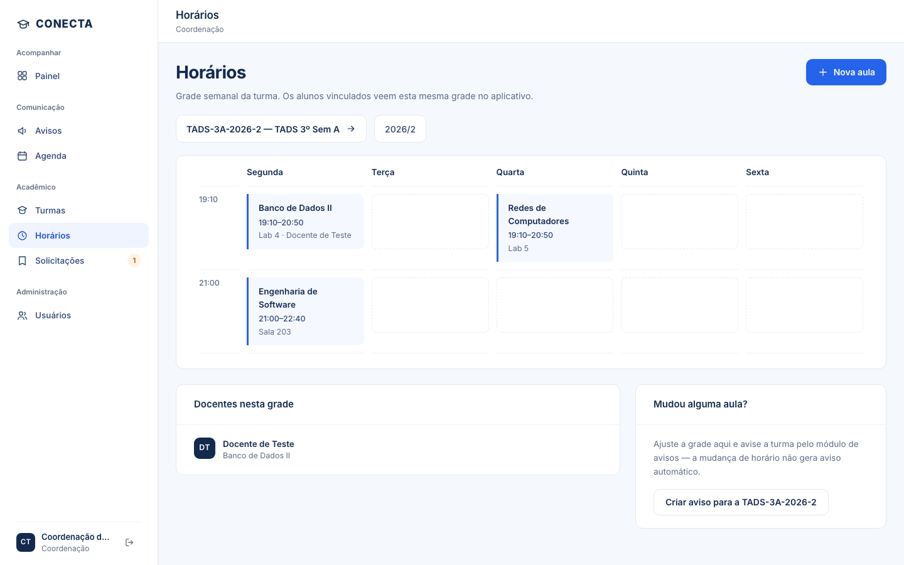

# Evidências da plataforma web — fase F2

01/11/2026. Fecha as fases 13 e 14 de [`tasks-f2.md`](../specs/001-plataforma-gestao/tasks-f2.md)
(T090–T100). A agenda (fases 11 e 12) entrou no [#25](https://github.com/ruansbueno/conecta/pull/25).
A saída completa de cada verificação está em [`testes-web-2026-11-01.txt`](testes-web-2026-11-01.txt).

## Resultado das verificações

| Verificação | Como | Resultado |
|---|---|---|
| Tipos e estilo | `npm run typecheck`, `npx eslint .` | sem erros |
| Unidade e componente | `npx vitest run` | 385 testes em 47 arquivos, todos passam |
| Ponta a ponta | `npx playwright test`, contra o servidor falso que segue o contrato da E3 | 54 testes, todos passam (rodados duas vezes seguidas) |
| Mensagens de erro | `tests/unit/mensagens-spec.test.ts` contra a tabela da seção 6 da spec (agora com `HORARIO_NAO_ENCONTRADO`) | spec e web iguais |
| Acessibilidade (T098) | `e2e/acessibilidade.spec.ts`: axe (WCAG 2.1 A e AA) na agenda, no mês, no editor com erros, no histórico do evento, na escolha da turma, na grade, na modal de aula e na grade com a mensagem de resultado | nenhuma violação |
| Só teclado (T098) | `e2e/teclado.spec.ts`: abas e calendário da agenda; célula vazia → nova aula, Esc devolve o foco, salvar e remover com confirmação | passa; foco visível; a mensagem final recebe o foco |
| Ponta a ponta da F2 (T096, T097) | `e2e/agenda.spec.ts` e `e2e/horarios.spec.ts` | coordenação cria, edita, arquiva, desarquiva e exclui um evento com histórico; o evento de vários dias aparece em cada dia do mês; o docente só publica para as suas turmas; a grade cria aula com choque de sala (salva e avisada), edita, remove e segue para o aviso da turma; o docente não vê Horários |

### Correções feitas nesta fase

- **Calendário do mês (fase 12):** o nome dos botões de dia ("Ver os eventos de 15 de novembro")
  não continha o texto visível ("15" e os títulos) — o axe acusou `label-content-name-mismatch`
  (WCAG 2.5.3). O nome agora é o texto visível com o complemento só para leitor de tela: "15 de
  novembro, 2 eventos: …".
- **Cartão de aula:** pelo mesmo motivo, o nome do cartão é o texto que se vê (disciplina, horas,
  local e docente); o dia vem do cabeçalho da coluna e "Abre a edição da aula." fica na descrição.
- **Revisão independente:** Esc numa confirmação aberta sobre a modal de aula fechava as duas e
  perdia o digitado (agora só o modal de cima responde a Esc e a Tab); um docente recusado (409)
  continuava no formulário sem aparecer, e o reenvio repetia o erro (agora a escolha volta a "Sem
  docente"); botões da modal com `aria-disabled` durante o envio, para o foco não cair no corpo da
  página; a modal não fecha enquanto envia; falha ao atualizar a grade não apaga os conflitos;
  turma inativa sem o link para o aviso; "no sábado", "no domingo".
- **Título da barra superior:** na grade de uma turma (`/turmas/:id/horarios`) mostrava "Turmas";
  passou a seguir a mesma regra da barra lateral, que marca "Horários".

## Telas comparadas com o design (T099)

Capturas em 1440×900, com Chrome headless em pt-BR, contra a API local real com os dados do seed.

| Design | Implementado | Diferenças deliberadas |
|---|---|---|
|  |  | Aba Arquivados a mais (D-F2-1). "Dia todo" não existe na API: evento sem fim mostra a hora de início, e a data importante sem fim mostra "até HH:MM" (D-F2-6). Excluir fica no detalhe do evento. Aba Mês sem desenho próprio, nos tokens da w-12: [captura](telas/w-12-agenda-mes.png) (D-F2-7). |
|  |  | Sem a legenda "Aula prática / Aula teórica" e sem "Grade atualizada em … por …": a API não guarda tipo de aula nem autoria da grade (D-F2-14). Sem as faixas "Intervalo" (D-F2-8). O cartão mostra também início–fim, e a célula vazia é um botão que abre a nova aula naquele dia e hora (decisões de 01/11/2026). O seletor da turma volta à [escolha da turma](telas/w-13-horarios-escolher-turma.png). [Modal de aula](telas/w-13-horarios-modal.png) sem desenho próprio. |
